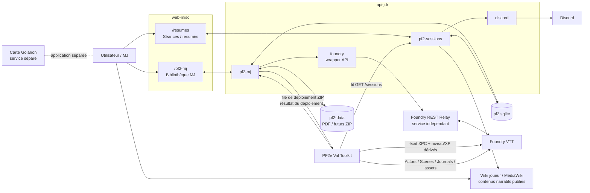

# architecture — documentation PF2

[← Outils](../../OUTILS.md) · [Archive intégrale](archive/RECAP-2026-09-27.md)

> Contenu repris de l'audit du 27 septembre 2026 : **historique à confronter au code et à l'état de production** avant de considérer une observation ou une anomalie comme actuelle.

## 1. Périmètre

Le système PF2 utile est composé de :

- l’application web `web-misc`, notamment :
  - `/pf2-mj` : bibliothèque MJ, catalogue, PNJ, lieux, régions, factions, événements, curation, préparation des scénarios ;
  - `/pf2-mj/lore` : lecteur de la bible narrative (`story.md` + `lore/*.md`) en lecture seule ; fichiers intégrés lors de la compilation du frontend ;
  - `/resumes` / `/résumés` : gestion des séances et résumés ;
- l’API NestJS `api-jdr`, notamment :
  - `pf2-mj` ;
  - `pf2-storage` ;
  - `pf2-sessions` ;
  - `foundry` ;
  - `discord` ;
- la base `pf2.sqlite` ;
- la bibliothèque physique `pf2-data` ;
- le service indépendant **Foundry REST Relay** ;
- le module Foundry **PF2e Val Toolkit** ;
- Foundry VTT ;
- Discord ;
- la carte de Golarion, application séparée ;
- le wiki joueur, connecté au backend via l’API MediaWiki pour les contenus narratifs publiés ;

Ne font **pas** partie du cœur PF2-MJ documenté ici :

- `apps/admin-jdr/` ;
- `libs/jdr/` ;
- `apps/web-misc/src/jdr/` ;
- `apps/web-misc/src/pf2/` ;
- Year Diary.

---

---

## 2. Vue d’ensemble



---

---

## 3. Sources de vérité

### 3.1 Données métier PF2

La source de vérité métier est **`pf2.sqlite`**.

Elle contient notamment :

- catalogue campagnes/scénarios ;
- PNJ ;
- lieux ;
- régions ;
- factions ;
- événements ;
- curation MJ ;
- séances ;
- relations scénario ↔ entités ;
- métadonnées de bibliothèque ;
- état des packages ZIP ;
- état des déploiements Foundry.

Les anciens JSON sous `apps/web-misc/src/pf2-mj/data` sont des seeds, rapports, exports ou données historiques. Ils ne doivent pas redevenir une source runtime concurrente de SQLite.

### 3.2 Fichiers physiques

La source de vérité physique est **`PF2_LIBRARY_ROOT`**, qui pointe sur `pf2-data` sur le mini-PC.

On y trouve :

- PDF ;
- cartes PDF ;
- guides ;
- traductions ;
- documents d’information ;
- futurs ZIP de scénarios / ressources Foundry.

SQLite ne stocke pas les gros fichiers eux-mêmes : elle stocke les chemins, métadonnées et associations.

### 3.3 Foundry

Foundry reste la source de vérité pour les objets mécaniques/visuels réellement présents dans le monde :

- Actors ;
- Scenes ;
- Journals ;
- Tokens ;
- état mécanique PF2e.

Les PNJ narratifs de l’application MJ ont un identifiant métier stable. Quand un Actor Foundry correspond à un PNJ, le lien stable côté référentiel est `foundryActorUuid`, et les Actors narratifs importés par le Toolkit utilisent :

```text
flags.pf2e-val-toolkit.npcId
```

### 3.4 XPC

L’historique permettant de recalculer l’XPC vient des séances enregistrées dans `pf2.sqlite`.

La valeur XPC matérialisée sur un PJ Foundry est :

```text
flags.pf2e-val-toolkit.xpc
```

Le Toolkit lit les séances via l’API et recalcule l’XPC des PJ.

---

---

## 6. Catalogue, campagnes, scénarios et PDF

### 6.1 Modèle runtime

Le frontend distingue :

- **Container** : campagne, collection, saison, série ;
- **PlayableUnit** : unité réellement jouable ;
- **Component** : guide, compilation, carte, ressource, traduction, document externe ;
- **CatalogueDocument** : PDF physique.

Seuls les `PlayableUnit` sont proposés comme parties à jouer.

### 6.2 Navigation MJ simplifiée

La navigation quotidienne est volontairement réduite à quatre domaines :

- **Journal MJ** : campagnes/aventures à jouer, en cours ou jouées ;
- **Catalogue** : navigation complète, recherche avancée, chronologie et mis de côté ;
- **Ressources** : bibliothèque indépendante de contenus réutilisables (titre, description courte, résumé détaillé, origine, tags, plusieurs PDF et rattachements optionnels aux campagnes/scénarios/composants jouables) ;
- **Monde** : PNJ, factions, lieux, régions et événements ;
- **Administration** : maintenance du catalogue, inventaire PDF, préparation technique et migrations.

`Trouver une partie` reste disponible comme recherche avancée du Catalogue ; l’ancien inventaire physique `Ressources PDF` est désormais nommé `Inventaire PDF` et reste en Administration sur `/pf2-mj/documents`. La bibliothèque métier `Ressources` possède sa propre entrée principale sur `/pf2-mj/resources` ; `Maintenance` et `Préparation technique` restent disponibles mais ne sont plus des entrées principales.

Les `arcIds` peuvent représenter une **campagne transverse** composée de scénarios PFS appartenant à plusieurs saisons. Une saison PFS reste un conteneur du catalogue, jamais automatiquement une campagne du Journal.

### 6.3 Scanner

`POST /api/pf2-mj/local-scan`

Le scanner :

1. parcourt `PF2_LIBRARY_ROOT` ;
2. ignore notamment `.DS_Store`, `._*` et `__MACOSX` ;
3. détecte PDF et ZIP ;
4. compare les chemins au catalogue ;
5. détecte déplacements et nouveaux documents ;
6. détecte certaines traductions ;
7. détecte les PDF d’information ;
8. construit l’inventaire des ZIP.

Sans `apply=true`, le scan ne modifie pas SQLite.

Avec `apply=true`, il peut persister :

- réconciliations PDF ;
- nouveaux documents ;
- inventaire ZIP.

### 6.4 Disponibilité documentaire

La disponibilité doit être comprise selon deux axes.

#### Couverture

```text
complete
partial
absent
```

`partial` décrit un manque réel de fichiers attendus. Il ne doit pas décrire la fidélité ou la longueur d’une traduction.

#### Mode disponible

```text
fr
en_trad
en
info
```

Un scénario est considéré prêt documentairement si :

```text
coverage = complete
```

et si le mode est :

```text
fr
en_trad
info
```

`en` seul reste disponible, mais n’est pas considéré prêt pour le workflow MJ actuel.

Le statut ZIP Foundry est indépendant de cette disponibilité documentaire.

### 6.5 Problème actuel connu : un PDF utilisé par plusieurs unités

Le modèle frontend V2→V3 construit actuellement **un seul `targetId` par fichier physique**.

C’est insuffisant pour une compilation qui contient plusieurs aventures.

Exemple : Agents d’Absalom.

Physiquement, les fichiers existent :

- Volume 1 ;
- Volume 2 ;
- guide joueur ;
- deux cartes.

Le catalogue logique contient six aventures.

Mais le fichier Volume 1 reste attaché à une cible documentaire unique, alors qu’il doit pouvoir satisfaire plusieurs aventures.

**Conséquence :** une aventure peut apparaître sans PDF alors que son contenu se trouve bien dans la compilation.

Ce point est une anomalie structurelle prioritaire à corriger.

---

---

## 17. Règles à ne pas réintroduire

### XPC

**Faux :**

```text
niveau = floor(XPC / 1000) + 1
XP PF2 = XPC % 1000
```

Ne jamais réintroduire cette règle.

### PNJ

Ne jamais fusionner sur le nom seul.

### Monstres

Ne pas transformer automatiquement un monstre, garde anonyme ou figurant mécanique en PNJ métier.

### JSON historiques

Ne pas remettre un JSON historique comme vérité runtime en parallèle de SQLite.

### PDF

Ne pas considérer qu’un fichier physique ne peut appartenir qu’à une seule unité logique.

### Déploiement Foundry

Ne pas marquer un package comme déployé tant que le Toolkit n’a pas renvoyé un succès réel.

---
