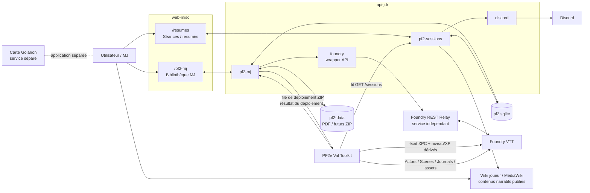

# Architecture PF2 — composants et sources de vérité

[← Outils](../../OUTILS.md)

## 1. Périmètre

Le système PF2 utile est composé de :

- l’application web `web-misc`, notamment :
  - `/pf2-mj` : bibliothèque MJ, catalogue, PNJ, lieux, régions, factions, événements, curation, préparation des scénarios ;
  - `/pf2-mj/lore` : lecteur de la bible narrative (`UNIVERS.md`, `PJ.md`, `CAMPAGNES.md` et `pf2/{univers,pj,campagnes}/**/*.md`) en lecture seule ; fichiers intégrés lors de la compilation du frontend ;
  - `/resumes` / `/résumés` : gestion des séances et résumés ;
- l’API NestJS `api-jdr`, notamment :
  - `pf2-mj` ;
  - `pf2-storage` ;
  - `pf2-sessions` ;
  - `foundry` ;
  - `discord` ;
- la base `pf2.sqlite` ;
- la bibliothèque physique `pf2-data` ;
- le service indépendant **Foundry REST Relay** ;
- le module Foundry **PF2e Val Toolkit** ;
- Foundry VTT ;
- Discord ;
- la carte de Golarion, application séparée ;
- le wiki joueur, connecté au backend via l’API MediaWiki pour les contenus narratifs publiés ;

Ne font **pas** partie du cœur PF2-MJ documenté ici :

- `apps/admin-jdr/` ;
- `libs/jdr/` ;
- `apps/web-misc/src/jdr/` ;
- `apps/web-misc/src/pf2/` ;
- Year Diary.

---

---

## 2. Vue d’ensemble



---

---

## 3. Sources de vérité

### 3.1 Données métier PF2

La source de vérité métier est **`pf2.sqlite`**.

Elle contient notamment :

- catalogue campagnes/scénarios ;
- PNJ ;
- lieux ;
- régions ;
- factions ;
- événements ;
- curation MJ ;
- séances ;
- relations scénario ↔ entités ;
- métadonnées de bibliothèque ;
- état des packages ZIP ;
- état des déploiements Foundry.

Les anciens JSON sous `apps/web-misc/src/pf2-mj/data` sont des seeds, rapports, exports ou données historiques. Ils ne doivent pas redevenir une source runtime concurrente de SQLite.

### 3.2 Fichiers physiques

La source de vérité physique est **`PF2_LIBRARY_ROOT`**, qui pointe sur `pf2-data` sur le mini-PC.

On y trouve :

- PDF ;
- cartes PDF ;
- guides ;
- traductions ;
- documents d’information ;
- futurs ZIP de scénarios / ressources Foundry.

SQLite ne stocke pas les gros fichiers eux-mêmes : elle stocke les chemins, métadonnées et associations.

### 3.3 Foundry

Foundry reste la source de vérité pour les objets mécaniques/visuels réellement présents dans le monde :

- Actors ;
- Scenes ;
- Journals ;
- Tokens ;
- état mécanique PF2e.

Les PNJ narratifs de l’application MJ ont un identifiant métier stable. Quand un Actor Foundry correspond à un PNJ, le lien stable côté référentiel est `foundryActorUuid`, et les Actors narratifs importés par le Toolkit utilisent :

```text
flags.pf2e-val-toolkit.npcId
```

### 3.4 XPC

L’historique permettant de recalculer l’XPC vient des séances enregistrées dans `pf2.sqlite`.

La valeur XPC matérialisée sur un PJ Foundry est :

```text
flags.pf2e-val-toolkit.xpc
```

Le Toolkit lit les séances via l’API et recalcule l’XPC des PJ.

---

---

## 6. Catalogue, campagnes, scénarios et PDF

### 6.1 Modèle runtime

Le frontend distingue :

- **Container** : campagne, collection, saison, série ;
- **PlayableUnit** : unité réellement jouable ;
- **Component** : guide, compilation, carte, ressource, traduction, document externe ;
- **CatalogueDocument** : PDF physique.

Seuls les `PlayableUnit` sont proposés comme parties à jouer.

### 6.2 Navigation MJ simplifiée

La navigation quotidienne est volontairement réduite à quatre domaines :

- **Journal MJ** : campagnes/aventures à jouer, en cours ou jouées ;
- **Catalogue** : navigation complète, recherche avancée, chronologie et mis de côté ;
- **Ressources** : bibliothèque indépendante de contenus réutilisables (titre, description courte, résumé détaillé, origine, tags, plusieurs PDF et rattachements optionnels aux campagnes/scénarios/composants jouables) ;
- **Monde** : PNJ, factions, lieux, régions et événements ;
- **Administration** : maintenance du catalogue, inventaire PDF, préparation technique et migrations.

`Trouver une partie` reste disponible comme recherche avancée du Catalogue ; l’ancien inventaire physique `Ressources PDF` est désormais nommé `Inventaire PDF` et reste en Administration sur `/pf2-mj/documents`. La bibliothèque métier `Ressources` possède sa propre entrée principale sur `/pf2-mj/resources` ; `Maintenance` et `Préparation technique` restent disponibles mais ne sont plus des entrées principales.

Les `arcIds` peuvent représenter une **campagne transverse** composée de scénarios PFS appartenant à plusieurs saisons. Une saison PFS reste un conteneur du catalogue, jamais automatiquement une campagne du Journal.

#### Campagnes transverses dans le Catalogue et le Journal

Le comportement courant distingue uniquement l'importance d'affichage, sans créer deux modèles métier concurrents :

- **campagne transverse longue** : 4 scénarios ou plus ;
- **campagne transverse courte** : 2 ou 3 scénarios.

Un scénario PFS membre d'une campagne transverse reste rattaché à sa saison dans les données, mais il est masqué de cette saison dans le Catalogue afin d'éviter un affichage en double. Les actions de curation portées par une campagne transverse se propagent à ses membres ; sélectionner directement un membre sélectionne également les autres membres encore non commencés, sans écraser un scénario déjà `En cours` ou `Joué`.

Le Journal MJ privilégie les campagnes et regroupe ensuite les aventures réellement autonomes sous **Scénarios individuels**. Il ne contient que le périmètre actif : `Sélectionné`, `En cours` et `Joué`.

### 6.3 Scanner

`POST /api/pf2-mj/local-scan`

Le scanner :

1. parcourt `PF2_LIBRARY_ROOT` ;
2. ignore notamment `.DS_Store`, `._*` et `__MACOSX` ;
3. détecte PDF et ZIP ;
4. compare les chemins au catalogue ;
5. détecte déplacements et nouveaux documents ;
6. détecte certaines traductions ;
7. détecte les PDF d’information ;
8. construit l’inventaire des ZIP.

Sans `apply=true`, le scan ne modifie pas SQLite.

Avec `apply=true`, il peut persister :

- réconciliations PDF ;
- nouveaux documents ;
- inventaire ZIP.

### 6.4 Disponibilité documentaire

La disponibilité doit être comprise selon deux axes.

#### Couverture

```text
complete
partial
absent
```

`partial` décrit un manque réel de fichiers attendus. Il ne doit pas décrire la fidélité ou la longueur d’une traduction.

#### Mode disponible

```text
fr
en_trad
en
info
```

Un scénario est considéré prêt documentairement si :

```text
coverage = complete
```

et si le mode est :

```text
fr
en_trad
info
```

`en` seul reste disponible, mais n’est pas considéré prêt pour le workflow MJ actuel.

Le statut ZIP Foundry est indépendant de cette disponibilité documentaire.

### 6.5 PDF de compilation et plusieurs unités jouables — état à tester

L'audit historique décrivait une insuffisance de liaison entre un PDF physique et plusieurs aventures d'un même volume (*Agents d'Absalom*). **Il ne faut plus présenter cette dette comme non corrigée par défaut.** Le code actuel de `Pf2MjService.libraryAssetsForScenario()` (consulté le 18 octobre 2026) utilise `scenarioResourceTargets()` et `scenarioDocumentLinks()` pour projeter les fichiers de volumes/composants sur la fiche d'une campagne ou d'un scénario, **sans dupliquer les liens SQLite**.

Cela démontre l'existence d'une projection, mais **pas** que toutes les compilations et tous les affichages fonctionnent parfaitement. Vérification fonctionnelle recommandée : six aventures d'Agents d'Absalom, volumes PDF partagés, inventaire effectif et états de disponibilité. Classer le résultat dans [travaux ouverts](travaux-ouverts.md) seulement après cette vérification.

### 6.6 Workflow opérationnel scénario → Foundry

Le workflow quotidien n'est plus l'ancien aller-retour manuel « préanalyse IA → export Foundry → retour IA ». Ce code de compatibilité existe encore, mais l'interface technique correspondante est volontairement masquée.

Pour un scénario réellement prioritaire, le chemin cible est :

```text
catalogue / SQLite courant
+ PDF déjà associés dans pf2-data
+ package-registry courant
+ références Foundry à la demande
→ analyse
→ package v4 validé
→ intégration API
→ demande de déploiement
→ Toolkit Foundry
→ Actors / Scenes / Journal / assets
→ résultat de déploiement vérifié
```

Principes :

1. retrouver l'unité canonique et ses documents depuis le catalogue avant de demander des fichiers au MJ ;
2. vérifier les entités métier et leurs IDs contre l'état **live** de SQLite / `package-registry`, pas contre un ancien snapshot ;
3. chercher d'abord les Actors mécaniques dans les références/compendiums Foundry et ne créer un `custom` que si nécessaire ;
4. conserver le ZIP v4 comme artefact compilé reproductible entre l'application et Foundry ;
5. intégrer le ZIP par l'API et utiliser la file de déploiement ; ne pas écrire directement dans LevelDB ;
6. considérer le succès renvoyé par le Toolkit comme preuve du déploiement ;
7. vérifier le résultat réel avant de déclarer la préparation terminée.

La fiche scénario quotidienne expose volontairement surtout **l'état Foundry et l'action utile suivante**. Les anciens contrôles de génération détaillés restent dans le code pour compatibilité, mais ne doivent plus structurer le workflow normal.

---

---

## Conventions techniques à préserver (ancien §17)

### XPC

**Faux :**

```text
niveau = floor(XPC / 1000) + 1
XP PF2 = XPC % 1000
```

Ne jamais réintroduire cette règle.

### PNJ

Ne jamais fusionner sur le nom seul.

### Monstres

Ne pas transformer automatiquement un monstre, garde anonyme ou figurant mécanique en PNJ métier.

### JSON historiques

Ne pas remettre un JSON historique comme vérité runtime en parallèle de SQLite.

### PDF

Ne pas considérer qu’un fichier physique ne peut appartenir qu’à une seule unité logique.

### Déploiement Foundry

Ne pas marquer un package comme déployé tant que le Toolkit n’a pas renvoyé un succès réel.

---
